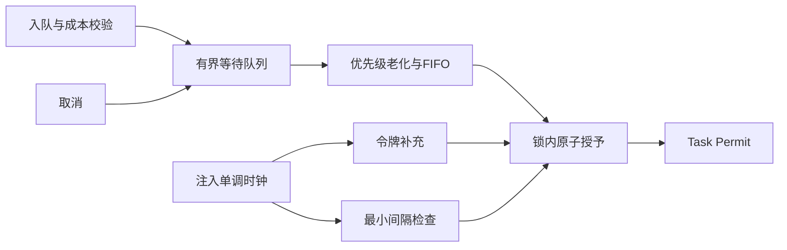

# Rate Limit Scheduler Lab

可注入单调时钟的准入调度器，将令牌桶、漏桶节拍、有界排队及优先级老化组合在同一原子授予边界内。

**项目来源：2026-10-30 新建、AI 辅助实现的独立工程演示；不是历史开源贡献或雇主生产代码。** 使用 .NET 9，无第三方 NuGet 依赖；不依赖真实等待，不创建后台线程，不执行用户工作回调。

## 运行

```sh
dotnet build tests/RateScheduler.Specs -c Release
dotnet run --project tests/RateScheduler.Specs -c Release --no-build
dotnet run --project demo/SchedulerDemo -c Release
```

## 技术重点

- **令牌桶**：容量控制初始突发，按单调时钟补充 `decimal` 令牌；请求具有整数成本，不能超过桶容量。支持速率范围为每秒 `0.000001` 至 `1,000,000,000` 令牌。
- **漏桶节拍**：可选的最小授予间隔限制请求频率；空闲后按当前时间建立下一时隙，不积攒“追赶突发”。间隔为零时保留令牌桶突发能力。
- **公平性**：优先级 0–9，每经过一个老化周期升一级，最高为 9；有效优先级相同时按入队顺序服务。持续供给令牌且持续 `Pump` 时，旧请求最终达到最高级，新请求不会无限插队。
- **明确排队策略**：队列有容量上限；严格优先顺序，因此高成本队首会阻挡便宜请求。这个取舍避免绕过老请求，也可能牺牲吞吐。
- **取消线性化**：取消在授予前胜出则移除请求且不耗令牌；授予先胜出则额度已经消费。任务延续异步运行，避免执行用户代码时持有内部锁。
- **时间与数值边界**：拒绝时钟倒退；在消耗令牌之前检查下一时隙溢出。时钟单位为 `TimeSpan.Ticks`，必须非负、单调。真实时钟适配器使用 `Stopwatch`。



## 调用契约

`Enqueue` 仅排队并返回 `Task<Permit>`，调用方需要主动调用 `Pump` 才会授予许可。`Pump(maxGrants)` 支持每次处理预算；返回实际授予数量。许可表示已经消耗准入额度，后续工作失败不会退款。

`Inspect` 只返回上次处理后的快照，不隐式补充令牌。取消会立即处理，无需等待 `Pump`；`Dispose` 令所有等待请求以 `ObjectDisposedException` 结束，已经授予的许可不受影响。队列满时同步抛出 `QueueFullException`，以让上游显式实施背压。它不是并发数限制器，许可不表示正在运行的工作已经释放。

## 验证

21 项可执行规格覆盖：令牌突发、小数边界、空闲补充上限、漏桶节拍、优先级与老化、队首阻塞、即时取消、取消与授予竞争、背压、时间倒退、数值溢出、销毁及预算。

- 500 路并发入队与 20 路 `Pump` 校验唯一授予和令牌守恒。
- 200 轮取消/授予竞争，检查每轮额度与最终任务状态一致。
- 2,000 步固定种子随机轨迹与独立的半秒整数令牌模型对照。
- 100 个请求的随机时间推进检查全部授予时间的最小间隔。

## 局限

这是单进程准入算法，不提供跨实例全局限流或持久化。全局锁用于展示原子性，队列选择为 `O(n log n)`，适合规格推导而非大队列吞吐。生产适配可改用分层队列、指标、定时唤醒与租户配额，但需要保留这里的取消、时间与公平性契约。没有用真实网络吞吐来声称性能。

源码入口：[`Scheduler.cs`](src/RateScheduler/Scheduler.cs)，验证入口：[`Program.cs`](tests/RateScheduler.Specs/Program.cs)。MIT 许可证。
